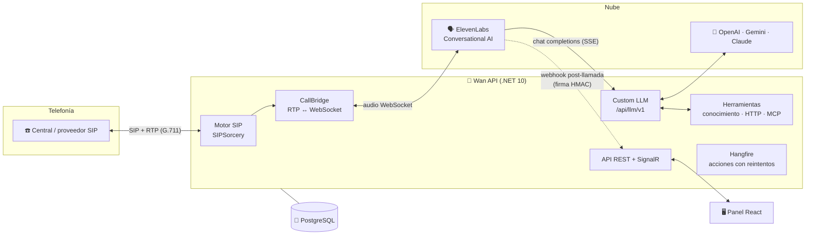
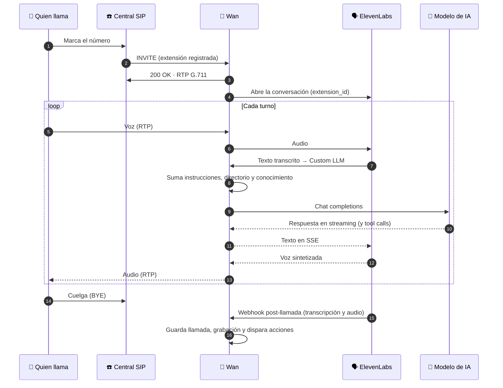
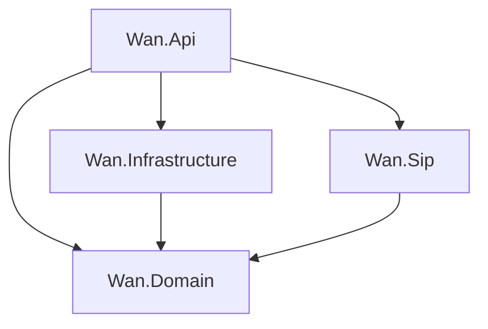

<div align="center">

# 🦝 Wan — Backend

**Motor SIP y API de un bot telefónico con IA.**
Registra tus cuentas SIP, atiende las llamadas con la voz de ElevenLabs y responde con OpenAI, Gemini o Claude.

[](LICENSE)
[](https://dotnet.microsoft.com/)
[](https://www.postgresql.org/)
[](https://github.com/sipsorcery-org/sipsorcery)
[](https://elevenlabs.io/conversational-ai)
[](https://modelcontextprotocol.io/)
[](#-docker)
[](#-contribuir)

[Documentación](docs/README.md) · [Arquitectura](docs/arquitectura.md) · [Instalación](docs/instalacion.md) · [API](docs/api.md) · [Panel (frontend)](../frontend/README.md)

</div>

---

## ✨ Qué hace

Wan es un **softphone con cerebro**. Funciona como MicroSIP: le das una cuenta SIP de cualquier central o proveedor y se registra. La diferencia es que las llamadas no las atiende una persona, sino un agente de voz con IA que:

| | |
|---|---|
| 📞 **Atiende en tu central** | Cualquier servidor SIP (Asterisk, FreePBX, 3CX, proveedores en la nube) por UDP, TCP o TLS, con servidor secundario, proxy, STUN y keepalive. |
| 🗣️ **Habla natural** | Voz de ElevenLabs, OpenAI Realtime o Deepgram, a elección y sin cambiar nada más. |
| 🧠 **Piensa con el modelo que elijas** | OpenAI, Gemini o Claude, con las API keys cifradas y configurables desde el panel. |
| 📚 **Sabe de tu negocio** | Bases de conocimiento con PDF, Word, Markdown, CSV o HTML y búsqueda de texto completo en español. |
| 🔌 **Consulta tus sistemas** | Peticiones HTTP a tu ERP o CRM y herramientas de cualquier servidor MCP. |
| 🔀 **Transfiere bien** | Un directorio de personas y áreas; transfiere con SIP REFER. |
| 📝 **Toma datos y recados** | Llena formularios durante la llamada y dispara webhooks, Teams, Google Chat, Slack o correo. |
| 🎙️ **Graba y transcribe** | Guarda el audio de cada conversación y la transcripción turno a turno. |
| 🤖 **Se deja operar por agentes** | Expone su propio servidor MCP con permisos por herramienta. |
| ⚡ **En vivo** | SignalR emite el estado de cada extensión, las llamadas, la transcripción y los recados nuevos. |

## 🏗️ Arquitectura



### Una llamada, paso a paso



Más detalle en [docs/arquitectura.md](docs/arquitectura.md).

## 🚀 Inicio rápido

### Con Docker (recomendado)

Desde la raíz del monorepo (carpeta que contiene `backend/` y `frontend/`):

```bash
cp .env.example .env                    # POSTGRES_PASSWORD
cp backend/.env.example backend/.env    # JWT, admin inicial, tokens del agente
docker compose up -d --build
```

Abre **http://localhost:8080** y entra con el admin de `Auth__BootstrapAdmin__*`.

### Con imágenes publicadas

```bash
docker pull ghcr.io/<usuario>/wan-api:latest
docker pull ghcr.io/<usuario>/wan-frontend:latest
```

El `docker-compose.yml` para producción está en [docs/despliegue.md](docs/despliegue.md).

### En local, sin Docker para la API

```bash
docker compose up -d db                 # solo Postgres
cd backend
dotnet user-secrets set "ConnectionStrings:Wan" "Host=localhost;Database=mapache;Username=mapache;Password=<POSTGRES_PASSWORD>" --project src/Wan.Api
dotnet user-secrets set "Auth:Jwt:SigningKey" "$(openssl rand -base64 48)" --project src/Wan.Api
dotnet run --project src/Wan.Api    # http://localhost:5238
```

La guía completa está en [docs/instalacion.md](docs/instalacion.md).

## 🧩 Estructura

```
backend/
├── src/
│   ├── Wan.Api/             # ASP.NET Core: controllers, SignalR, Hangfire, MCP server, auth
│   ├── Wan.Domain/          # Entidades y contratos, sin dependencias externas
│   ├── Wan.Infrastructure/  # EF Core, cifrado, LLM, conocimiento, herramientas, acciones
│   └── Wan.Sip/             # Motor SIP y puente de audio a ElevenLabs
├── tests/Wan.Tests/         # xUnit: audio, firmas, LLM, herramientas
├── docs/                        # Documentación completa
└── Dockerfile
```



## 🛠️ Stack

| Área | Tecnología |
|------|------------|
| Runtime | .NET 10 · ASP.NET Core |
| Telefonía | [SIPSorcery](https://github.com/sipsorcery-org/sipsorcery) (SIP, RTP, STUN) |
| Voz | ElevenLabs Conversational AI (WebSocket + Custom LLM + webhooks) |
| IA | OpenAI · Gemini (API compatible) · Claude ([SDK oficial de Anthropic](https://github.com/anthropics/anthropic-sdk-csharp)) |
| Datos | PostgreSQL 17 + EF Core (Npgsql) · búsqueda full-text `spanish` |
| MCP | [ModelContextProtocol](https://github.com/modelcontextprotocol/csharp-sdk) (cliente y servidor) |
| Trabajos | Hangfire (PostgreSQL) |
| Tiempo real | SignalR |
| Correo | MailKit |
| Documentos | PdfPig (PDF) y lectura de .docx |
| Logs | Serilog |
| Seguridad | JWT · ASP.NET Data Protection · HMAC |

## 📖 Documentación

| Guía | Contenido |
|------|-----------|
| [Arquitectura](docs/arquitectura.md) | Capas, flujo de una llamada, decisiones de diseño |
| [Instalación](docs/instalacion.md) | Docker, local, primer arranque |
| [Configuración](docs/configuracion.md) | Todas las variables y claves de `appsettings` |
| [Proveedores de voz](docs/voz.md) | ElevenLabs, OpenAI Realtime o Deepgram |
| [ElevenLabs](docs/elevenlabs.md) | Cómo crear y conectar el agente de ElevenLabs |
| [Motor SIP](docs/motor-sip.md) | Cuentas, transporte, NAT, llamadas entrantes |
| [LLM del bot](docs/llm.md) | Custom LLM, proveedores, contexto y bucle de herramientas |
| [Conocimiento](docs/conocimiento.md) | Bases de conocimiento y búsqueda |
| [Herramientas](docs/herramientas.md) | Peticiones HTTP y servidores MCP externos |
| [Servidor MCP](docs/servidor-mcp.md) | Exponer Wan a Claude, Cursor y otros agentes |
| [Formularios y recados](docs/formularios.md) | Formularios, acciones, generación con IA, recados, grabaciones |
| [API](docs/api.md) | Referencia de endpoints |
| [Seguridad](docs/seguridad.md) | Autenticación, secretos y cifrado |
| [Despliegue](docs/despliegue.md) | Imágenes Docker, GitHub Actions, red y producción |
| [Desarrollo](docs/desarrollo.md) | Pruebas, migraciones y convenciones |

## 🐳 Docker

Cada push a `main` y cada tag `v*.*.*` publica la imagen multi-arquitectura (`linux/amd64`, `linux/arm64`) con [GitHub Actions](.github/workflows/docker.yml):

| Evento | Tags |
|--------|------|
| push a `main` | `main`, `sha-<commit>` |
| tag `v1.2.3` | `1.2.3`, `1.2`, `1`, `latest` |
| pull request | se compila, no se publica |

Se publica en `ghcr.io/<usuario>/wan-api`, y también en Docker Hub si el repositorio tiene los secretos `DOCKERHUB_USERNAME` y `DOCKERHUB_TOKEN`.

## 🤝 Contribuir

Wan es **open source**. Los issues y pull requests son bienvenidos:

1. Haz un fork y crea una rama (`git checkout -b mi-mejora`).
2. Sigue las convenciones de [docs/desarrollo.md](docs/desarrollo.md): código en inglés, comentarios y commits en español.
3. Deja `dotnet build` sin warnings nuevos y `dotnet test` en verde.
4. Abre el pull request contando qué cambia y por qué.

Nunca subas secretos (credenciales SIP ni API keys): van en user-secrets o en `.env`, que están fuera de git.

## 📄 Licencia

[MIT](LICENSE) © 2026 **Steven Gazo Maliaño**
