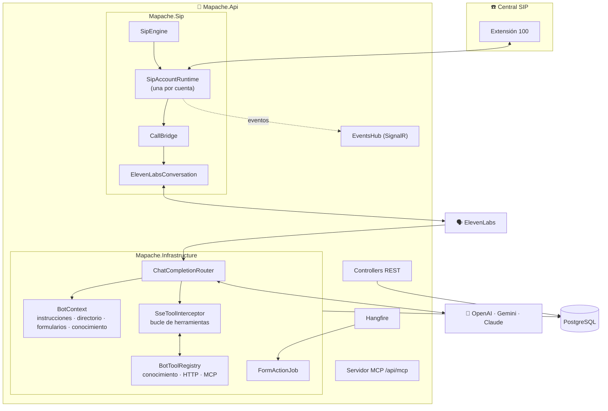
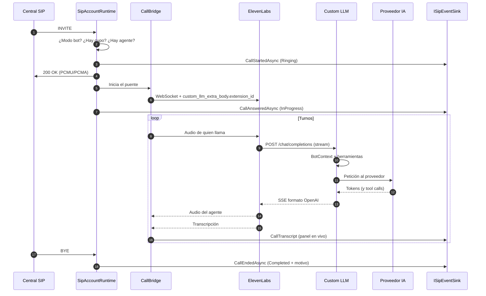
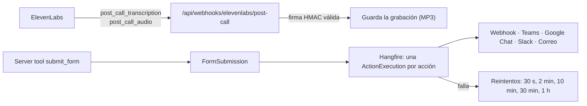

# 🏗️ Arquitectura

## Vista general

Mapache divide el trabajo de una llamada en tres partes:

| Parte | Quién la hace | Por qué |
|-------|---------------|---------|
| **Telefonía** (SIP, RTP) | Mapache, con SIPSorcery | Para registrarse en cualquier central, igual que un softphone, sin depender de un proveedor. |
| **Voz** (reconocimiento, síntesis, turnos, interrupciones) | ElevenLabs Conversational AI | Es la parte más difícil de hacer bien y con baja latencia. |
| **Razonamiento** (qué responder, qué herramienta usar) | Mapache como *Custom LLM* + el proveedor elegido | Para controlar el contexto, las herramientas y el proveedor sin atarse a ElevenLabs. |

## Capas

| Proyecto | Responsabilidad | Depende de |
|----------|-----------------|------------|
| `Mapache.Domain` | Entidades (`Extension`, `Call`, `FormTemplate`...) y contratos. | nada |
| `Mapache.Infrastructure` | EF Core, cifrado (`ISecretProtector`), clientes de LLM, conocimiento, herramientas, acciones de formularios. | Domain |
| `Mapache.Sip` | Motor SIP, puente de audio, cliente WebSocket de ElevenLabs. | Domain |
| `Mapache.Api` | Composición: controllers, autenticación, SignalR, Hangfire, servidor MCP y los adaptadores que conectan el motor SIP con la base. | todos |

`Mapache.Sip` no conoce la base ni la API. Recibe lo que necesita por tres contratos que implementa la API ([`Sip/SipBindings.cs`](../src/Mapache.Api/Sip/SipBindings.cs)):

- `ISipAccountSource`: las cuentas habilitadas, con la contraseña ya descifrada.
- `IVoiceAgentSource`: la API key y el agente de ElevenLabs.
- `ISipEventSink`: registro, llamada iniciada, contestada, transcripción y fin. La API lo persiste y lo avisa por SignalR.

## Flujo de una llamada entrante

Los casos que no terminan en el bot:

| Situación | Respuesta SIP | Estado de la llamada |
|-----------|---------------|----------------------|
| Modo *Persona* | `480 Temporarily Unavailable` | Perdida |
| Se alcanzó el límite de llamadas simultáneas | `486 Busy Here` | Perdida |
| Falta configurar ElevenLabs | `503 Service Unavailable` | Fallida, con el motivo |

## Qué pasa después de colgar

## Decisiones de diseño

- **Custom LLM en vez del LLM de ElevenLabs.** Así se elige el proveedor desde el panel, se cambian las instrucciones sin tocar el agente y se inyecta contexto (directorio, conocimiento, formularios) en cada turno.
- **Herramientas dentro del Custom LLM.** Las de Mapache se ejecutan en el mismo request, sin ida y vuelta por ElevenLabs. El texto previo ("déjame revisar") sale en el momento y la voz no se corta.
- **Búsqueda de texto completo en vez de embeddings.** Responde en milisegundos, funciona con cualquier proveedor (Claude no tiene API de embeddings) y no suma costo por documento. La imagen de Postgres ya trae pgvector por si se necesita más adelante.
- **Un solo proceso.** El motor SIP, la API, Hangfire y el servidor MCP corren en el mismo contenedor. Es más simple de operar y basta para decenas de llamadas simultáneas.
- **Secretos cifrados en la base.** Las contraseñas SIP, las API keys y los secretos de webhooks van con ASP.NET Data Protection; la API nunca los devuelve.
