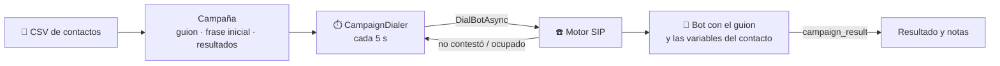

# 📣 Campañas de llamadas salientes

El bot llama a una lista de contactos con un guion: recordatorios de citas, cobros, encuestas, seguimiento de ventas.

## Crear una campaña

| Campo | Para qué |
|-------|----------|
| Extensión | Desde qué cuenta SIP se llama; aplica su prefijo, su límite de simultáneas y su horario |
| Guion | Objetivo e indicaciones del bot. Admite `{{nombre}}`, `{{telefono}}` y cualquier columna del CSV (`{{monto}}`, `{{fecha}}`) |
| Frase inicial | Lo primero que dice el bot al contestar ("Hola {{nombre}}, te llamo de…") |
| Resultados | Opciones con las que el bot registra cada llamada. Siempre existe «No volver a llamar» |
| Simultáneas | Llamadas a la vez (1–20) |
| Intentos y espera | Cuántas veces reintentar a quien no contesta o da ocupado, y cada cuántos minutos |
| Solo en horario | No marca fuera del horario de atención de la extensión |

## Contactos (CSV)

- La primera fila son los nombres de columna. Obligatoria una de teléfono: `telefono`, `teléfono`, `phone`, `numero` o `celular`. Opcional `nombre`.
- El resto de las columnas son variables del guion; los nombres se normalizan ("Monto adeudado" → `{{monto_adeudado}}`).
- Separador coma o punto y coma (Excel en español), valores entre comillas.
- Los números repetidos o inválidos se informan y se saltean. Máximo 10 000 por importación.

## Cómo marca

- El marcador (`CampaignDialer`) revisa cada 5 segundos las campañas **En curso**: respeta las simultáneas y el horario, y toma los pendientes cuyo reintento ya venció.
- **Contestó** → el bot sigue el guion y registra el resultado con `campaign_result` (resultado y notas).
- **No contestó / ocupado** → vuelve a la cola después de la espera, hasta agotar los intentos.
- Las llamadas de campaña aparecen en el historial, se pueden **tomar** desde el panel y el bot puede **transferir** como en las entrantes.
- Si la API se reinicia a mitad de una llamada, ese contacto vuelve a la cola.
- Cuando no quedan pendientes ni llamadas en curso, la campaña pasa a **Terminada**.

## Proveedores de voz

| Proveedor | Frase inicial |
|-----------|---------------|
| OpenAI Realtime | ✅ |
| Deepgram | ✅ (`agent.greeting`) |
| ElevenLabs | Requiere permitir sobrescribir el primer mensaje en el agente (Security → Overrides) |

## Buenas prácticas y normativa

- Llamar solo a personas que dieron su consentimiento y respetar los horarios que permita la ley de tu país.
- Identificar siempre a la empresa en la frase inicial.
- Respetar «No volver a llamar»: el contacto no se vuelve a marcar en esa campaña; conviene excluirlo también de las próximas.
- Hoy no hay detección de contestador automático: si atiende un buzón, el bot habla igual.

## Estado de las pruebas

Probado con una llamada SIP real y OpenAI Realtime: apertura con el nombre del contacto, respuesta del "cliente", resultado «Interesado» con el correo en las notas y la campaña terminada sola.
