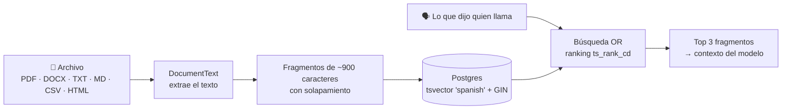

# 📚 Bases de conocimiento

Para que el bot conteste con información de tu negocio: políticas, precios, horarios, preguntas frecuentes.

## Cómo funciona

1. **Carga:** se suben archivos a una base (hasta 20 MB cada uno). Se guarda el texto, no el archivo.
2. **Extracción:** PdfPig para PDF; el `.docx` se lee como zip; el resto como texto (HTML sin etiquetas).
3. **Fragmentos:** ~900 caracteres con solapamiento, para no cortar una idea a la mitad.
4. **Índice:** cada fragmento tiene una columna `tsvector` calculada por Postgres (`to_tsvector('spanish', SearchText)`) sobre el texto en minúsculas y sin tildes, con índice GIN.
5. **Búsqueda:** en cada turno se busca con lo último que dijo quien llama (palabras unidas con OR y ordenadas por `ts_rank_cd`) en las bases activas, y los 3 mejores fragmentos entran al contexto.

El modelo también tiene la herramienta `search_knowledge_base` para buscar algo puntual con sus propias palabras.

## ¿Por qué texto completo y no embeddings?

| | Texto completo (actual) | Embeddings |
|---|---|---|
| Latencia | Milisegundos, dentro de Postgres | Una llamada extra a una API por turno |
| Proveedor | Cualquiera, incluido Claude | Necesita una API de embeddings |
| Costo | Nulo | Por documento y por consulta |
| Sinónimos | Limitado (stemming en español) | Mejor |

La imagen de Postgres ya trae pgvector por si en el futuro conviene una búsqueda híbrida.

## Desde el panel

- **Conocimiento → Nueva base:** nombre, descripción y si está activa.
- **Subir archivos:** varios a la vez.
- **Probar búsqueda:** muestra qué fragmentos recibiría el bot para una pregunta (`POST /api/knowledge/search`).
- **Desactivar una base** la saca del contexto sin borrarla.
