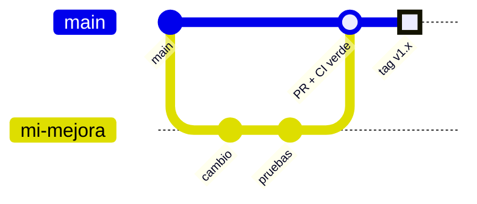

# 🧑‍💻 Desarrollo

## Comandos

```bash
dotnet build                              # compilar la solución
dotnet test                               # pruebas (xUnit)
dotnet run --project src/Wan.Api      # API en http://localhost:5238
```

### En Windows con Smart App Control

Si Windows bloquea las DLLs recién compiladas al correr `dotnet test` o `dotnet ef`, corre en el contenedor del SDK:

```bash
docker run --rm -v "$PWD:/src" -w /src mcr.microsoft.com/dotnet/sdk:10.0 dotnet test
```

## Pruebas

`tests/Wan.Tests` cubre la lógica pura, sin base ni red:

| Carpeta | Qué prueba |
|---------|------------|
| `Sip/` | Conversión de audio G.711, jitter buffer, medición de latencia |
| `Api/` | Firma HMAC del webhook de ElevenLabs |
| `Llm/` | Traducción a Claude, SSE de chat completions, enrutamiento por proveedor, contexto del bot, bucle de herramientas, formularios, conocimiento, cliente MCP, payloads de acciones |

La integración con la central se prueba a mano con un Asterisk en Docker ([motor-sip.md](motor-sip.md#probar-con-asterisk)).

## Migraciones

Se aplican solas al arrancar. Para crear una:

```bash
dotnet ef migrations add <Nombre> \
  --project src/Wan.Infrastructure \
  --startup-project src/Wan.Api \
  --output-dir Persistence/Migrations
```

Revisa los `defaultValue` que genera EF al agregar columnas no nulas: para enums y jsonb debe ser un valor válido (`"Bot"`, `"[]"`), no `""`.

## Convenciones

| Tema | Regla |
|------|-------|
| Idioma | Código e identificadores en inglés; comentarios, documentación, mensajes de error y commits en español |
| Comentarios | Solo cuando explican un porqué no obvio (rarezas de SIP, RTP o de una API) |
| DTOs | `record` junto al controller; nunca exponer entidades de EF |
| Consultas | Proyectar a DTO con `Select` **después** de filtrar y ordenar |
| Validación | DataAnnotations con mensajes en español; errores como ProblemDetails |
| Enums | Como texto en JSON y en la base (`HasConversion<string>()`) |
| Tiempo | `TimeProvider` inyectado, no `DateTime.UtcNow` |
| Logs | Serilog con plantillas (`{Propiedad}`), nunca interpolación; nunca loguear secretos |
| Tiempo real | `IHubContext<EventsHub, IEventsClient>`; un evento nuevo se escucha también en el panel |
| Segundo plano | Hangfire, no `Task.Run` sueltos |
| Secretos | Cifrados con `ISecretProtector`; la API nunca los devuelve |

## Agregar una herramienta al servidor MCP

1. Agrega un método con `[McpServerTool]` y `[Description]` en [`Mcp/WanMcpTools.cs`](../src/Wan.Api/Mcp/WanMcpTools.cs).
2. Si solo consulta, márcala con `ReadOnly = true`: el panel la muestra en *Consultar*. Sin eso aparece en *Modificar datos*.
3. Los tokens con acceso total la reciben sola; los demás la ven en el panel para activarla.

## Flujo de contribución



1. Rama desde `main`.
2. Cambios pequeños y enfocados, con pruebas si es lógica pura.
3. `dotnet build` sin warnings nuevos y `dotnet test` en verde.
4. Pull request: el workflow corre las pruebas y compila la imagen.
