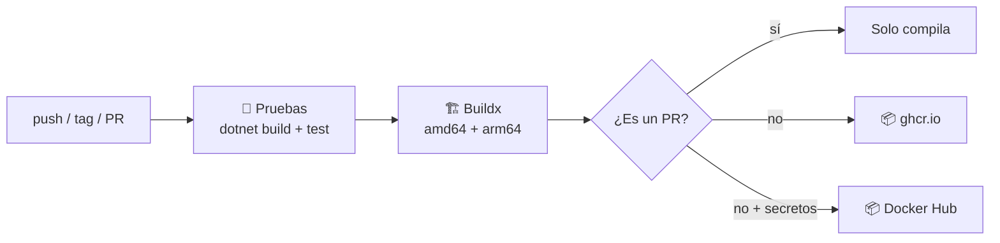
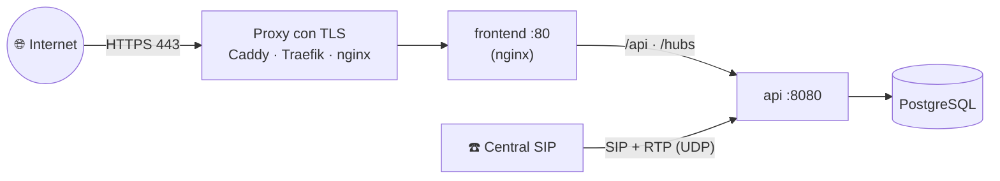

# 🐳 Despliegue

## Imágenes Docker

| Imagen | Contenido | Puerto |
|--------|-----------|--------|
| `ghcr.io/<usuario>/wan-api` | API, motor SIP, Hangfire y servidor MCP (.NET 10, usuario sin privilegios) | `8080` |
| `ghcr.io/<usuario>/wan-frontend` | Panel compilado servido por nginx, con proxy a `api:8080` | `80` |

Las dos son multi-arquitectura: `linux/amd64` y `linux/arm64` (sirve para Raspberry Pi 4/5 o servidores ARM).

## GitHub Actions

El workflow [`.github/workflows/docker.yml`](../.github/workflows/docker.yml) de cada repositorio:



| Evento | Tags publicados |
|--------|-----------------|
| push a `main` | `main`, `sha-<commit>` |
| tag `v1.2.3` | `1.2.3`, `1.2`, `1`, `latest` |
| pull request | ninguno (solo compila) |
| manual (*Run workflow*) | según la rama |

### Configuración

- **GitHub Container Registry:** no requiere nada. Usa el `GITHUB_TOKEN` del workflow con permiso `packages: write`. La primera vez, el paquete queda privado: hazlo público en *Packages → Package settings* si quieres que cualquiera lo descargue.
- **Docker Hub (opcional):** agrega en *Settings → Secrets and variables → Actions*:

  | Secreto | Valor |
  |---------|-------|
  | `DOCKERHUB_USERNAME` | Tu usuario de Docker Hub |
  | `DOCKERHUB_TOKEN` | Un *access token* de Docker Hub con permiso de escritura |

  Con esos secretos, las imágenes se publican también como `docker.io/<usuario>/wan-api`.

### Publicar una versión

```bash
git tag v1.0.0
git push origin v1.0.0
```

## docker-compose con imágenes publicadas

```yaml
services:
  db:
    image: pgvector/pgvector:pg17
    environment:
      POSTGRES_DB: mapache
      POSTGRES_USER: mapache
      POSTGRES_PASSWORD: ${POSTGRES_PASSWORD:?falta POSTGRES_PASSWORD}
    volumes:
      - db-data:/var/lib/postgresql/data
    healthcheck:
      test: ["CMD-SHELL", "pg_isready -U mapache -d mapache"]
      interval: 5s
      retries: 10
    restart: unless-stopped

  api:   # el nombre importa: nginx del panel hace proxy a http://api:8080
    image: ghcr.io/<usuario>/wan-api:latest
    env_file: ./backend.env
    environment:
      ConnectionStrings__Wan: Host=db;Database=mapache;Username=mapache;Password=${POSTGRES_PASSWORD}
      Sip__RtpPortStart: 40000
      Sip__RtpPortEnd: 40100
    ports:
      - "5060:5060/udp"
      - "40000-40100:40000-40100/udp"
    volumes:
      - recordings:/app/data/recordings
    depends_on:
      db:
        condition: service_healthy
    restart: unless-stopped

  frontend:
    image: ghcr.io/<usuario>/wan-frontend:latest
    ports:
      - "8080:80"
    depends_on:
      - api
    restart: unless-stopped

volumes:
  db-data:
  recordings:
```

`backend.env` lleva las mismas variables que [`backend/.env.example`](../.env.example). Publica el puerto SIP que configures como *puerto local* en cada extensión.

## Producción



- **HTTPS obligatorio:** ElevenLabs solo llama a URLs `https`. Pon un proxy con TLS (Caddy lo hace automático) delante del frontend.
- **WebSocket:** el proxy debe permitir el *upgrade* en `/hubs/` (SignalR) y no hacer buffer en `/api/mcp`.
- **Red SIP:** en Linux, `network_mode: host` en la API es lo más simple para SIP y RTP. Si no, publica el puerto SIP y el rango RTP fijo. Ver [motor-sip.md](motor-sip.md#red-y-nat).
- **Respaldos:** la base (incluida `DataProtectionKeys`) y el volumen `recordings`.
- **Actualizar:** `docker compose pull && docker compose up -d`. Las migraciones se aplican solas al arrancar.
- **Logs:** fuera de Development, Serilog escribe JSON compacto por consola, listo para Loki, Elastic o CloudWatch.
