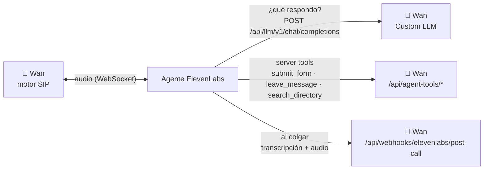

# 🗣️ Conectar ElevenLabs

ElevenLabs pone la voz: escucha, transcribe, sintetiza y maneja los turnos. Las respuestas las arma Wan (Custom LLM).

## 1. Crear el agente

En ElevenLabs → *Conversational AI* → *Agents*, crea un agente en blanco:

| Opción | Valor |
|--------|-------|
| Idioma | Español (u otro) |
| Primer mensaje | El saludo. Si grabas llamadas, incluye aquí el aviso: se dice antes de consultar al LLM. |
| Voz | La que prefieras |
| Formato de audio de entrada y salida | **μ-law 8000 Hz**, así el audio pasa sin convertir (passthrough) |

## 2. Custom LLM

En la sección *LLM* del agente:

| Campo | Valor |
|-------|-------|
| LLM | **Custom LLM** |
| Server URL | `https://<tu-host>/api/llm/v1` (ElevenLabs agrega `/chat/completions`) |
| API key | Un secreto con el mismo valor que `AgentWebhooks:ToolToken` |
| Enviar *extra body* | Activado: por ahí viaja el `extension_id` de la llamada |

El panel muestra la URL exacta en Configuración → IA.

## 3. Server tools (opcionales)

Cada tool es de tipo *Webhook*, método `POST`, con el header `Authorization` de tipo *Secret* y valor `Bearer <AgentWebhooks:ToolToken>`.

| Tool | URL | Para qué |
|------|-----|----------|
| `submit_form` | `/api/agent-tools/forms/submit` | Guardar un formulario llenado en la llamada |
| `leave_message` | `/api/agent-tools/messages` | Tomar un recado |
| `search_directory` | `/api/agent-tools/directory/search` | Buscar a quién transferir |

En los parámetros `conversation_id` y `caller_number`, usa las variables de sistema `system__conversation_id` y `system__caller_id`. Así la respuesta o el recado se enlazan con la grabación.

Para probar la configuración: `POST /api/agent-tools/ping` con el mismo header debe responder 200.

Wan solo le explica al modelo los formularios o los recados si el agente tiene la tool correspondiente: pedirle usar una herramienta que no existe lo confunde.

## 4. Webhook post-llamada

En *Settings* → *Webhooks* de ElevenLabs:

| Campo | Valor |
|-------|-------|
| URL | `https://<tu-host>/api/webhooks/elevenlabs/post-call` |
| Eventos | Transcripción y, para grabar, **Send audio data** |
| Secreto | Cópialo a `AgentWebhooks:PostCallSecret` |

Wan valida el header `ElevenLabs-Signature` (HMAC-SHA256 de `"{t}.{body}"`) y rechaza firmas de más de 30 minutos.

## 5. Conectar en el panel

Configuración → ElevenLabs: pega la API key (se guarda cifrada) y el ID del agente. Las llamadas siguientes ya lo usan, sin reiniciar.

## Requisito: Wan accesible desde internet

ElevenLabs llama al Custom LLM, a las tools y al webhook desde su nube, así que la API debe tener una URL pública con HTTPS. Para desarrollar en local sirve un túnel (Cloudflare Tunnel, ngrok, etc.) apuntando a `http://localhost:8080`.
