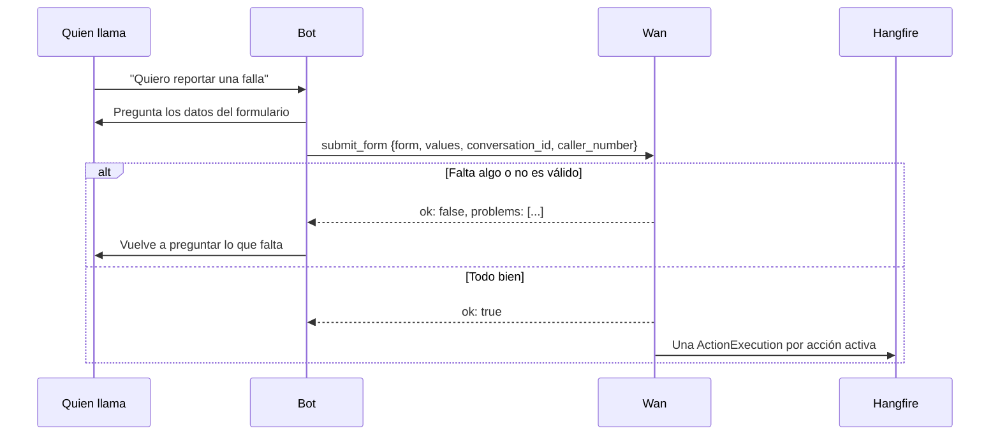

# 📋 Formularios, recados y grabaciones

## Formularios

Un formulario es lo que el bot debe preguntar y registrar durante la llamada: una solicitud de soporte, una cita, un pedido.

| Tipo de campo | Normalización |
|---------------|---------------|
| Texto | Se guarda tal cual |
| Número | Se valida; acepta coma o punto decimal |
| Teléfono | Al menos 6 dígitos; se dejan solo dígitos y `+` |
| Correo | Se valida el formato y se pasa a minúsculas |
| Sí / no | Acepta "sí", "no", "verdadero", "falso"...; se guarda como `Sí` / `No` |
| Fecha | Se guarda como la dijo quien llama ("el martes", "15 de octubre") |
| Opciones | Debe coincidir con una opción, sin importar mayúsculas ni tildes |

Cada campo tiene clave, etiqueta, tipo, si es obligatorio y una ayuda para el bot.

### Cómo llega un formulario



`submit_form` responde siempre 200: si falta algo, devuelve `ok: false` con `problems` para que el bot vuelva a preguntar en lugar de fallar.

### Crear con IA

El botón **Crear con IA** recibe una descripción ("formulario para agendar visitas técnicas con dirección y horario preferido") y devuelve un borrador que se revisa en el editor antes de guardar. Ver [llm.md](llm.md#formularios-generados-con-ia).

### Acciones

Cada respuesta nueva dispara las acciones activas del formulario:

| Tipo | Destino | Qué se envía |
|------|---------|--------------|
| 🔗 **Webhook** | URL propia | `POST` JSON con `event: "form.submitted"`, formulario y respuesta (`values` por clave y `fields` con etiquetas). Con secreto: `X-Wan-Signature: sha256=<HMAC-SHA256 del cuerpo>` |
| 🟣 **Teams** | Flujo "Publicar en un canal cuando se reciba una solicitud de webhook" | Tarjeta adaptable |
| 🟢 **Google Chat** | Webhook de un espacio | Texto con los datos |
| 🟡 **Slack** | Incoming webhook | Texto con los datos |
| ✉️ **Correo** | Destinatarios separados por coma | HTML y texto por el SMTP configurado (STARTTLS en 587, TLS en 465) |
| 🔌 **API (CRM, ERP…)** | Cualquier API: URL con marcadores, método, headers cifrados | El cuerpo que definas, con los datos mapeados por marcadores (ver abajo) |

### Enviar a cualquier sistema (CRM, ERP, Service Desk)

La acción **API** arma la petición que espera el sistema destino, sin código:

| Parte | Ejemplo |
|-------|---------|
| Método | `POST`, `PUT`, `PATCH`, `GET` o `DELETE` |
| URL | `https://desk.miempresa.com/api/tickets?origen=wan`; admite marcadores (se codifican para URL) |
| Headers | `Authorization: Bearer …`, `X-Api-Key: …`; se guardan **cifrados** |
| Cuerpo | JSON con marcadores; vacío = el JSON estándar del webhook |

**Marcadores:** cada campo del formulario por su clave (`{{nombre}}`, `{{problema}}`) y además:

| Marcador | Valor |
|----------|-------|
| `{{caller_number}}` | Número de quien llamó |
| `{{summary}}` | Texto con "Etiqueta: valor" por línea, ideal para descripciones |
| `{{values}}` | Objeto JSON con todos los campos |
| `{{form_name}}`, `{{form_id}}` | El formulario |
| `{{submission_id}}`, `{{conversation_id}}`, `{{created_at}}` | La respuesta y la conversación |

En el cuerpo cada marcador se inserta ya como valor JSON (el texto con comillas), así que se escriben sin comillas:

```json
{
  "requester": {{nombre}},
  "subject": {{problema}},
  "phone": {{caller_number}},
  "description": {{summary}},
  "custom_fields": {{values}}
}
```

Con secreto de firma, también lleva `X-Wan-Signature`. Si el destino responde con error, se reintenta como las demás acciones y el error queda visible en la respuesta.

**Reintentos:** si el destino falla, Hangfire reintenta 5 veces (30 s, 2 min, 10 min, 30 min, 1 h). El panel muestra el estado, los intentos y el último error de cada acción, con un botón para reintentar. *Probar* envía una respuesta de ejemplo en el momento.

**Verificar la firma del webhook** (Node.js):

```js
import crypto from 'node:crypto'

const expected = 'sha256=' + crypto.createHmac('sha256', SECRET).update(rawBody).digest('hex')
const ok = crypto.timingSafeEqual(Buffer.from(expected), Buffer.from(req.headers['x-wan-signature']))
```

## Recados

Cuando alguien no puede atender, el bot toma un recado con la tool `leave_message`:

| Dato | Descripción |
|------|-------------|
| `recipient` | Para quién. Se enlaza con el directorio si hay una sola coincidencia clara. |
| `message` | El recado |
| `caller_name`, `callback_number` | Quién llamó y a dónde devolver la llamada |
| `urgent` | Si es urgente |
| `conversation_id` | Enlaza el recado con la grabación |

En el panel, los recados pasan por los estados **Nuevo → Leído → Resuelto** y llegan en vivo.

### Compartir un recado (WhatsApp)

**Compartir** genera un enlace público con vencimiento (1 hora, 24 horas, 7 o 30 días) para mandarlo por WhatsApp u otro canal. Quien lo abre ve el recado, el número para devolver la llamada (se toca para llamar) y, si la llamada se grabó, puede escucharla, sin iniciar sesión.

- El enlace es el id del recado firmado con vencimiento (ASP.NET Data Protection): no se guarda nada y vence solo.
- Deja de funcionar si se borra el recado. Si se filtró, bórralo o espera a que venza.
- La página pública responde con `Cache-Control: no-store` y `X-Robots-Tag: noindex`.
- La URL usa la **URL pública** de Configuración → General.

## Grabaciones

Con **Grabar llamadas** activo (Configuración → Llamadas) se graba cada llamada; con OpenAI y Deepgram graba Wan y con ElevenLabs llega por webhook. Se guardan en disco, S3 o Azure: ver [grabaciones.md](grabaciones.md).

- Con ElevenLabs, el webhook post-llamada guarda el MP3 de los eventos `post_call_audio`.
- Una conversación se guarda una sola vez aunque ElevenLabs reintente el webhook.
- El aviso de grabación se agrega a las instrucciones del bot. Conviene ponerlo también en el primer mensaje del agente.
- El panel reproduce el audio con soporte de rangos (se puede adelantar).

Informar que la llamada se graba suele ser obligatorio: revisa la normativa de tu país.
