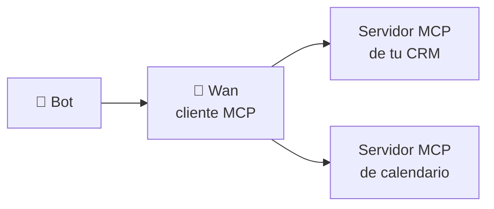

# 🔌 Herramientas del bot

Lo que el bot puede **consultar o hacer** durante la llamada. Wan las ejecuta dentro del Custom LLM y le devuelve el resultado al modelo en el mismo turno (ver [llm.md](llm.md#herramientas-y-bucle)).

## Peticiones HTTP

Para consultar tu ERP, CRM o cualquier API: el saldo de un cliente, el estado de un pedido, la disponibilidad de una cita.

| Campo | Descripción |
|-------|-------------|
| Nombre | Nombre de la herramienta para el modelo (`consultar_pedido`) |
| Descripción | Cuándo usarla. Es lo que el modelo lee para decidir. |
| Método y URL | `GET https://erp.miempresa.com/pedidos/{{numero}}` |
| Headers | Por ejemplo `Authorization`. Se guardan **cifrados**. |
| Cuerpo | JSON con `{{parametro}}` |
| Parámetros | Nombre, tipo (texto, número o sí/no), descripción y si es obligatorio |
| Timeout | Segundos máximos de espera |

**Plantillas:**

- En la URL, `{{parametro}}` se codifica para URL.
- En el cuerpo, se inserta como valor JSON (con comillas si es texto), así no se rompe el JSON.

**Respuesta:** se compacta (sin espacios de más) y se recorta a 4000 caracteres para no llenar el contexto.

**Probar:** el botón *Probar* (`POST /api/http-tools/{id}/test`) ejecuta la petición con valores de ejemplo y muestra el estado y la respuesta.

### Ejemplo

```
Nombre:       consultar_pedido
Descripción:  Estado y fecha de entrega de un pedido. Úsala cuando pregunten por un pedido.
Método/URL:   GET https://erp.ejemplo.com/api/pedidos/{{numero}}
Headers:      Authorization: Bearer ****
Parámetros:   numero (texto, obligatorio): número de pedido que dice el cliente
```

## Servidores MCP externos

Conecta cualquier servidor [MCP](https://modelcontextprotocol.io/) con transporte HTTP (Streamable HTTP o SSE) y elige qué herramientas puede usar el bot.



1. **Herramientas → Conectar servidor MCP:** nombre, URL y headers (cifrados).
2. Al guardar, Wan se conecta y lee la lista de herramientas.
3. Desactiva las que no quieras exponer al bot: por defecto quedan todas habilitadas.
4. *Volver a leer* (`/sync`) actualiza la lista si el servidor cambió.
5. *Probar* ejecuta una herramienta con argumentos de ejemplo.

El modelo las ve como `mcp_<servidor>_<herramienta>`.

## Herramientas del agente de ElevenLabs

Las server tools que se configuran en el propio agente (`submit_form`, `leave_message`, `search_directory`) las ejecuta ElevenLabs llamando a `/api/agent-tools/*`. Ver [elevenlabs.md](elevenlabs.md#3-server-tools-opcionales).

## Buenas prácticas

- **Descripciones claras:** el modelo elige la herramienta por su descripción. Di cuándo usarla y qué devuelve.
- **Respuestas cortas:** si la API devuelve mucho, filtra del lado del servidor. Todo lo que llega al modelo suma latencia.
- **Solo lectura cuando se pueda:** que el bot consulte es más seguro que modificar.
- **Timeouts cortos:** quien llama está esperando. Entre 3 y 8 segundos.
