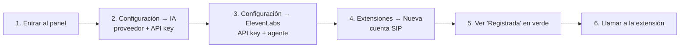

# 🚀 Instalación

## Requisitos

| Para | Necesitas |
|------|-----------|
| Correr todo en Docker | Docker con Compose v2 |
| Desarrollar la API | [.NET SDK 10](https://dotnet.microsoft.com/download) y Docker (para Postgres) |
| Que el bot hable | Una cuenta de [ElevenLabs](https://elevenlabs.io) y una API key de OpenAI, Gemini o Anthropic |
| Recibir llamadas | Una cuenta SIP (de tu central o de un proveedor) |

## Opción 1: todo en Docker

El monorepo tiene esta forma:

```
Wan/
├── docker-compose.yml   # db + api + frontend
├── .env                 # POSTGRES_PASSWORD
├── backend/             # este repositorio (.env con los secretos de la API)
└── frontend/
```

1. **Variables de la base**

   ```bash
   cp .env.example .env
   # POSTGRES_PASSWORD=<una contraseña larga>
   ```

2. **Secretos de la API**

   ```bash
   cp backend/.env.example backend/.env
   ```

   | Variable | Cómo generarla |
   |----------|----------------|
   | `Auth__Jwt__SigningKey` | `openssl rand -base64 48` |
   | `Auth__BootstrapAdmin__Email` / `__Password` | El primer admin, que se crea si la base no tiene usuarios |
   | `AgentWebhooks__ToolToken` | `openssl rand -hex 32` (se configura también en ElevenLabs) |
   | `AgentWebhooks__PostCallSecret` | Lo genera ElevenLabs al crear el webhook post-llamada |

3. **Levantar**

   ```bash
   docker compose up -d --build
   docker compose logs -f api
   ```

4. Abre **http://localhost:8080** e inicia sesión con el admin inicial.

Al arrancar, la API aplica las migraciones pendientes y crea el admin si hace falta.

## Opción 2: API en local

```bash
docker compose up -d db
cd backend

dotnet user-secrets set "ConnectionStrings:Wan" "Host=localhost;Port=5432;Database=mapache;Username=mapache;Password=<POSTGRES_PASSWORD>" --project src/Wan.Api
dotnet user-secrets set "Auth:Jwt:SigningKey" "$(openssl rand -base64 48)" --project src/Wan.Api
dotnet user-secrets set "Auth:BootstrapAdmin:Email" "admin@wan.local" --project src/Wan.Api
dotnet user-secrets set "Auth:BootstrapAdmin:Password" "<contraseña>" --project src/Wan.Api
dotnet user-secrets set "AgentWebhooks:ToolToken" "$(openssl rand -hex 32)" --project src/Wan.Api
dotnet user-secrets set "AgentWebhooks:PostCallSecret" "<secreto de ElevenLabs>" --project src/Wan.Api

dotnet run --project src/Wan.Api
```

- La API queda en `http://localhost:5238`.
- En Development el documento OpenAPI está en `/openapi/v1.json` y el panel de Hangfire en `/hangfire` (solo desde localhost).
- [`Wan.Api.http`](../src/Wan.Api/Wan.Api.http) trae requests de ejemplo para VS Code o Rider.

Para el panel, en otra terminal: `cd frontend && npm install && npm run dev` (http://localhost:5173).

## Primer arranque: checklist



1. **IA:** elige el proveedor activo, pega su API key y, si quieres, las instrucciones del bot.
2. **ElevenLabs:** crea el agente como se explica en [elevenlabs.md](elevenlabs.md) y pega su API key e ID.
3. **Extensión:** servidor, usuario y contraseña SIP. En segundos el panel muestra si quedó registrada o por qué falló (por ejemplo, `401 Unauthorized` es usuario o contraseña incorrectos).
4. **Probar:** llama a la extensión desde otro teléfono de la central.

## Problemas frecuentes

| Síntoma | Causa probable |
|---------|----------------|
| La API no arranca: `falta ConnectionStrings:Wan` | Falta la cadena de conexión (user-secrets o `.env`). |
| `401 Unauthorized` al registrar | Usuario, contraseña o *usuario de autenticación* incorrectos. |
| Se registra pero no entran llamadas | NAT: la central no llega al contenedor. Ver [motor-sip.md](motor-sip.md#red-y-nat). |
| La llamada entra y se corta con `503` | Falta la API key o el ID del agente de ElevenLabs. |
| El bot contesta pero no habla | El agente no tiene configurado el Custom LLM o el token no coincide. Ver [elevenlabs.md](elevenlabs.md). |
| Windows bloquea `dotnet test` o `dotnet ef` | *Smart App Control* bloquea DLLs nuevas: corre las pruebas en el contenedor del SDK ([desarrollo.md](desarrollo.md)). |
