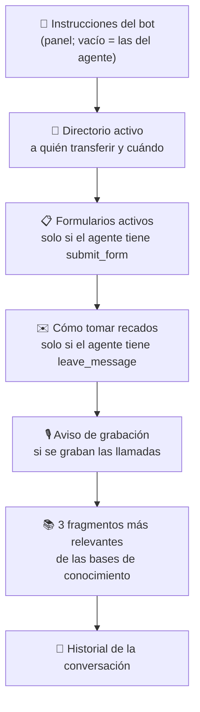
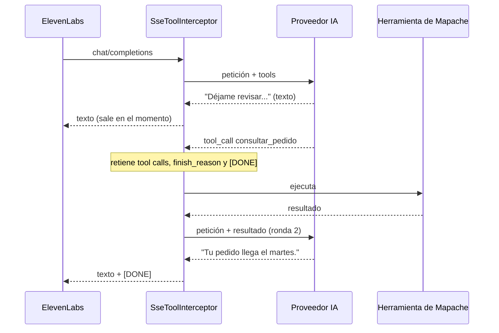

# 🧠 LLM del bot (Custom LLM)

En cada turno de la conversación, ElevenLabs le pregunta a Mapache qué responder. Mapache arma el contexto, consulta al proveedor elegido, ejecuta las herramientas que hagan falta y devuelve la respuesta en streaming.

```
POST /api/llm/v1/chat/completions
Authorization: Bearer <AgentWebhooks:ToolToken>
```

El endpoint habla el formato de *chat completions* de OpenAI con `stream: true`, que es lo que espera ElevenLabs.

## Proveedores

| Proveedor | Cómo se llama | Modelo por defecto |
|-----------|---------------|--------------------|
| **OpenAI** | Chat completions, reenvío directo | `gpt-4.1-mini` |
| **Gemini** | [API compatible con OpenAI](https://ai.google.dev/gemini-api/docs/openai) | `gemini-2.5-flash` |
| **Claude** | Messages API con el SDK oficial (`AnthropicChatClient`) | `claude-opus-5` |

Se configuran en **Configuración → IA**: proveedor activo, API key y modelo de cada uno. Se guardan los tres, así cambiar de proveedor es un clic. Las keys van cifradas y la API nunca las devuelve.

### Claude

`AnthropicChatClient` traduce mensajes, tools y resultados de tools del formato de OpenAI al de Anthropic (`AnthropicRequestTranslator`), y reescribe el streaming a SSE de OpenAI (`ChatCompletionChunkWriter`).

- Usa esfuerzo bajo (`effort: low`) para responder rápido; en Haiku no se envía porque no lo admite.
- En los modelos que lo soportan pide el *fallback* del servidor ante rechazos. Si aun así declina, el bot dice una frase de cortesía en lugar de quedarse callado.

## Contexto que recibe el modelo

`BotContext` agrega mensajes de sistema después de las instrucciones:



El conocimiento se busca en cada turno con lo último que dijo quien llama (ver [conocimiento.md](conocimiento.md)).

## Herramientas y bucle

A las tools que trae ElevenLabs, Mapache suma las suyas (`BotToolRegistry`):

- `search_knowledge_base`, si hay alguna base activa con contenido;
- cada **petición HTTP** activa;
- cada herramienta habilitada de los **servidores MCP**, con el nombre `mcp_<servidor>_<herramienta>`;
- `transfer_call`, si la extensión está en horario de atención y el directorio tiene destinos (ver [motor-sip.md](motor-sip.md#transferencias-y-horario-de-atención)).

El motor SIP manda en `custom_llm_extra_body` el `extension_id` y el `call_id` de la llamada: con ellos el Custom LLM sabe el horario de la extensión y a qué llamada aplicar la transferencia.

Si el agente ya tiene una tool con el mismo nombre, gana la del agente.



- El texto sale enseguida, así la voz no se corta mientras se ejecuta la herramienta.
- Si todas las tool calls son del agente de ElevenLabs, lo retenido se entrega tal cual y ElevenLabs las ejecuta.
- Hasta **4 rondas** de herramientas internas por turno; se envía un solo `[DONE]` al final.

## Formularios generados con IA

`POST /api/forms/generate` con `{"description": "..."}` usa el mismo proveedor en modo JSON estructurado (`LlmJsonClient`):

| Proveedor | Mecanismo |
|-----------|-----------|
| OpenAI / Gemini | `response_format: json_schema` estricto |
| Claude | `output_config.format` del SDK oficial |

`FormGenerator.Sanitize` deja el borrador válido aunque el modelo se desvíe: claves únicas en snake_case, tipos conocidos, opciones solo en campos de selección y como máximo 25 campos.
