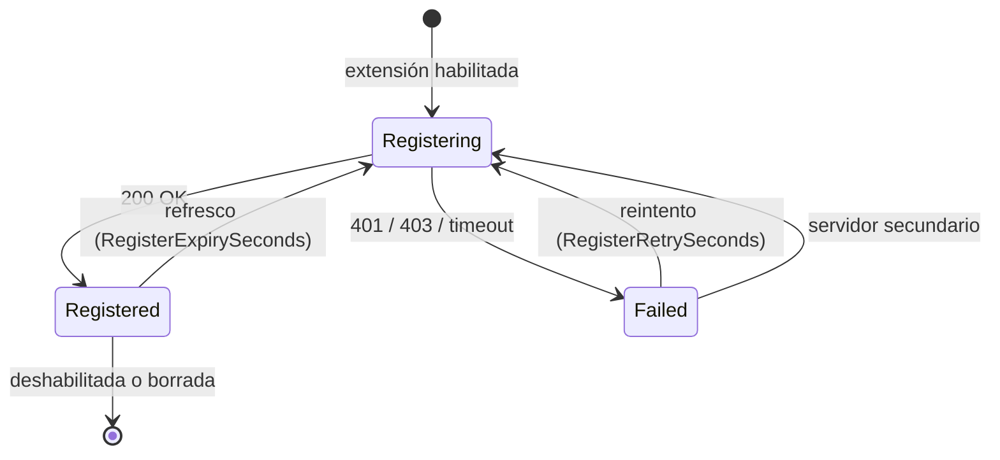
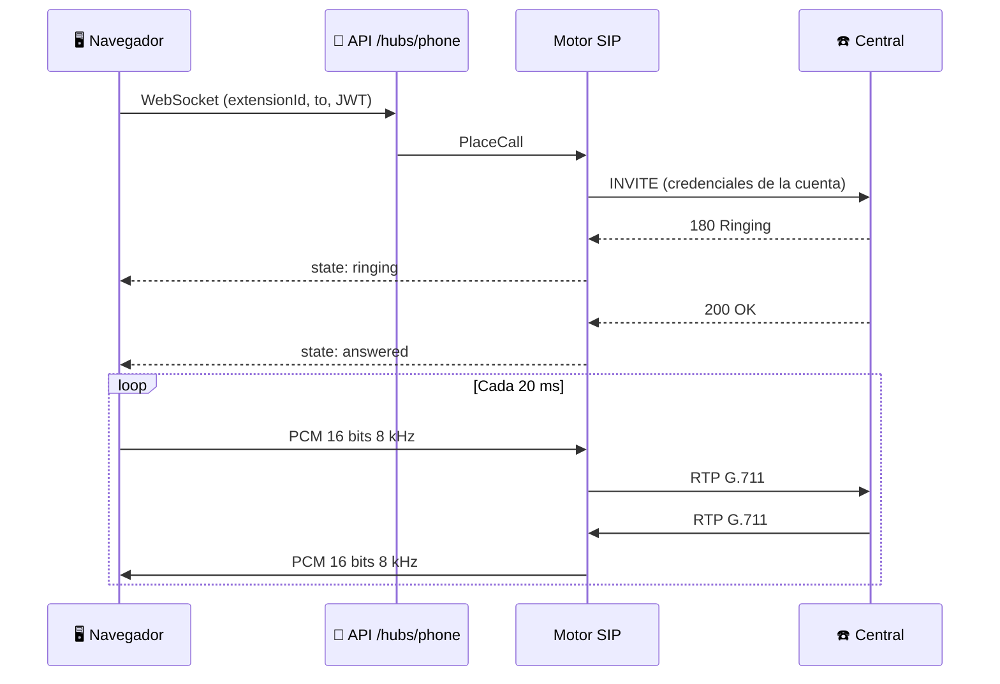

# ☎️ Motor SIP

`SipEngine` ([`src/Mapache.Sip/Engine/`](../src/Mapache.Sip/Engine)) corre dentro de la API y mantiene registrada cada extensión habilitada, como un softphone con varias cuentas.

## Ciclo de vida



El motor lee las cuentas:

- al arrancar;
- cuando se crea, edita o borra una extensión (`RequestReload`);
- cada minuto, por si algo cambió por fuera.

Una cuenta cuya configuración cambió se des-registra y se vuelve a crear. Cada cambio de estado llega al panel por SignalR (`ExtensionStatusChanged`).

## Piezas

| Clase | Qué hace |
|-------|----------|
| `SipEngine` | Sincroniza las cuentas con la base y expone sus estados (`GetStatuses`). |
| `SipAccountRuntime` | Una cuenta: transporte, REGISTER, paso al servidor secundario, keepalive y llamadas entrantes. |
| `CallBridge` | Puente RTP ↔ WebSocket de ElevenLabs: jitter buffer, frames de 20 ms, barge-in, DTMF y transferencia (REFER). |
| `ElevenLabsConversation` | Cliente del WebSocket del agente. Envía `custom_llm_extra_body.extension_id`. |
| `AudioConverter` | Conversión G.711 μ-law / A-law ↔ PCM y remuestreo. |
| `JitterBuffer` | Reordena paquetes RTP y absorbe variaciones de la red. |
| `LatencyTracker` | Mide la latencia turno a turno y resume p50/p90/máximo al colgar. |

## Opciones de la extensión

| Grupo | Opción | Aplica |
|-------|--------|:------:|
| Cuenta | Servidor, servidor secundario, proxy, dominio, usuario, usuario de autenticación, contraseña, nombre para mostrar | ✅ |
| Red | Transporte UDP / TCP / TLS, puerto local | ✅ |
| NAT | IP pública, servidor STUN, reescritura de IP, keepalive (doble CRLF) | ✅ |
| Registro | Expiración y reintento | ✅ |
| Audio | Códecs (PCMU y PCMA para el bot) | ✅ |
| Llamadas | Llamadas simultáneas y quién contesta (bot, bot con paso a persona, persona) | ✅ |
| Seguridad | SRTP, ICE | 🕓 se guarda, pendiente |
| Avanzado | Refresco de sesión, DTMF por SIP INFO o en banda | 🕓 se guarda, pendiente |
| Salientes | Prefijo de marcado | ✅ |
| Salientes | Buzón, número oculto | 🕓 se guarda, pendiente |

## Llamadas entrantes

| Modo | Comportamiento |
|------|----------------|
| **Bot** | Contesta el agente de ElevenLabs. |
| **Bot con paso a persona** | Contesta el agente, que puede transferir usando el directorio. |
| **Persona** | Responde `480` hasta que exista el softphone del panel. |

Con el límite de simultáneas alcanzado responde `486 Busy Here`. Una misma extensión puede atender varias llamadas a la vez; cada una tiene su propio puente y su propia conversación en ElevenLabs. El límite real lo pone también la central o el proveedor.

Cada llamada queda guardada con dirección, estado, motivo de fin y transcripción, y el panel la ve en vivo (`CallsChanged`, `CallTranscript`).

## Transferencias y horario de atención

El bot transfiere con la herramienta `transfer_call` del Custom LLM: el motor busca la llamada en curso y hace una transferencia ciega (REFER) al destino.

- **Solo destinos del directorio:** por destino exacto o por nombre si la coincidencia es única. El modelo no puede marcar números arbitrarios, lo que evita fraude con números de pago.
- **Horario por extensión:** días, apertura, cierre, un descanso opcional y la zona horaria (IANA). Fuera de horario o en el descanso:
  - el Custom LLM no ofrece `transfer_call` y le indica al bot que no transfiera, que diga el **mensaje de fuera de horario** (o el de descanso) y que ofrezca tomar un recado;
  - el motor también rechaza la transferencia por si el modelo la pide igual.
- Sin horario activado, la extensión está siempre abierta.

## Llamadas salientes (teléfono web)

La página **Teléfono** del panel marca desde cualquier extensión activa, para probarla sin un softphone:



- Sale siempre por el proxy o el servidor de la cuenta, con su usuario de autenticación, su nombre para mostrar y su **prefijo de marcado**.
- El destino puede ser un número, una extensión, un código de servicio (`*43`, `#`) o un URI SIP completo.
- Cuenta para el límite de llamadas simultáneas y queda en el historial como saliente, con su motivo de fin ("colgaste", "ocupado", "no contestó"…).
- DTMF por RFC 2833 desde el teclado de la página.

## Red y NAT

Para recibir llamadas, la central tiene que poder llegar a Mapache:

- **La IP y el puerto de señalización** de cada cuenta (el puerto local o uno asignado).
- **Los puertos RTP** del audio.

| Entorno | Recomendación |
|---------|---------------|
| Linux en producción | `network_mode: host` para la API, o publicar el puerto SIP y el rango `Sip:RtpPortStart`–`RtpPortEnd`. |
| Central en la misma red Docker | Funciona sin configuración extra. |
| Docker Desktop (Windows / Mac) | Sirve para probar: el keepalive mantiene abierto el NAT. No es apto para producción. |
| Proveedor en internet detrás de NAT | Configura IP pública o STUN y deja el keepalive activo. |

## Qué mirar en los logs

| Log | Significado |
|-----|-------------|
| `Registrando <usuario>@<servidor>` | Inicio del registro. |
| `401 Unauthorized` | Usuario o contraseña incorrectos. |
| `Bridge iniciado` | Códec negociado, formatos de ElevenLabs y si hay passthrough. |
| `Latencia turno` | Una línea por turno. La meta es menos de ~1,5 s. |

## Probar con Asterisk

Para probar sin una central real se puede levantar un Asterisk en la misma red de Docker:

```bash
docker run -d --name mapache-pbx --network mapache_default andrius/asterisk
```

Configura un endpoint PJSIP (por ejemplo `100` con contraseña) y crea en el panel una extensión con servidor `mapache-pbx`, usuario `100` y esa contraseña.
