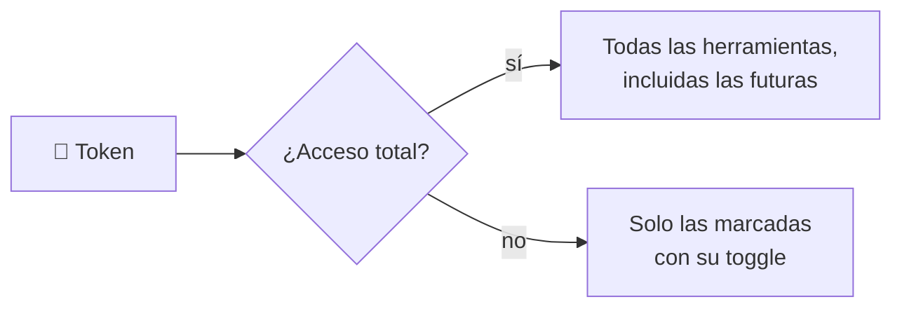

# 🤖 Servidor MCP de Mapache

Mapache expone un servidor [MCP](https://modelcontextprotocol.io/) para que Claude, Cursor u otros agentes consulten y operen el sistema: leer recados, marcar los atendidos, revisar respuestas de formularios, buscar en el directorio o en el conocimiento.

```
URL:        https://<tu-host>/api/mcp
Transporte: Streamable HTTP (sin estado)
Auth:       Authorization: Bearer mapache_mcp_...
```

## Herramientas

| Herramienta | Tipo | Qué hace |
|-------------|------|----------|
| `search_knowledge_base` | Consultar | Busca en las bases de conocimiento activas |
| `search_directory` | Consultar | Busca personas y áreas del directorio |
| `list_messages` | Consultar | Lista los recados, con filtro por estado (`pending`, `new`, `done`, `all`) |
| `list_forms` | Consultar | Lista los formularios, con sus campos y cuántas respuestas nuevas tienen |
| `list_form_submissions` | Consultar | Respuestas de un formulario |
| `update_message_status` | Modificar datos | Cambia el estado de un recado: `new`, `read` o `done` |

## Tokens y permisos

Los tokens se crean en **Configuración → Acceso por MCP** (solo admins):



- Cada cliente con su token, para poder revocarlos por separado.
- **Acceso total:** todas las herramientas, también las que se agreguen en versiones futuras.
- **Por herramienta:** se activan con toggles, agrupados en *Consultar* y *Modificar datos*.
- Los permisos se pueden cambiar después sin crear otro token.
- Se guarda solo el SHA-256 del token: el valor completo se muestra **una vez**, al crearlo.

**Cómo se aplican** ([`Mcp/McpToolPermissions.cs`](../src/Mapache.Api/Mcp/McpToolPermissions.cs)):

- `tools/list` devuelve solo las herramientas permitidas: el agente ni siquiera ve las demás.
- `tools/call` de una herramienta no permitida responde con `isError: true` y el mensaje "Este token no tiene permiso para usar …".
- Un token revocado o inexistente recibe `401`.

## Conectar clientes

### Claude Code

```bash
claude mcp add --transport http mapache https://<tu-host>/api/mcp \
  --header "Authorization: Bearer mapache_mcp_..."
```

### Cursor y otros clientes con HTTP

```json
{
  "mcpServers": {
    "mapache": {
      "url": "https://<tu-host>/api/mcp",
      "headers": { "Authorization": "Bearer mapache_mcp_..." }
    }
  }
}
```

### Claude Desktop

Claude Desktop conecta servidores locales, así que se usa `mcp-remote` como puente:

```json
{
  "mcpServers": {
    "mapache": {
      "command": "npx",
      "args": [
        "mcp-remote",
        "https://<tu-host>/api/mcp",
        "--header",
        "Authorization: Bearer mapache_mcp_..."
      ]
    }
  }
}
```

El panel muestra estos fragmentos con la URL y el token recién creado ya puestos.

## Detrás de nginx

nginx sirve `/api/mcp` sin buffer y con timeout de una hora, porque las respuestas van en streaming (SSE). Si usas otro proxy, desactiva el buffering para esa ruta.
