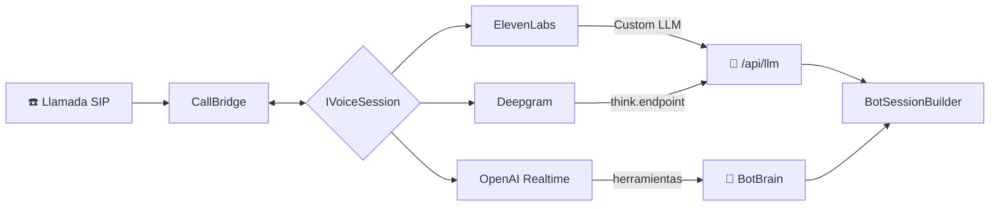

# 🗣️ Proveedores de voz

Wan no depende de un solo proveedor: la voz se elige en **Configuración → Voz** y se puede cambiar en cualquier momento, sin reiniciar.

| Proveedor | Cómo responde el bot | Audio | Para qué conviene |
|-----------|----------------------|-------|-------------------|
| **ElevenLabs** | Custom LLM de Wan | µ-law 8 kHz | Voces muy naturales y clonadas |
| **OpenAI Realtime** | Modelo de voz a voz de OpenAI, con las instrucciones y herramientas de Wan | µ-law 8 kHz | Muy poca latencia, un solo proveedor (misma key que la IA) |
| **Deepgram Voice Agent** | Custom LLM de Wan | µ-law 8 kHz | Menor costo por minuto |

En los tres casos el bot usa lo mismo: instrucciones, directorio, formularios, recados, bases de conocimiento, peticiones HTTP, servidores MCP, transferencias y horario de atención (`BotSessionBuilder`).

## ElevenLabs

Ver [elevenlabs.md](elevenlabs.md). El agente se crea en ElevenLabs con LLM **Custom LLM** apuntando a `https://<host>/api/llm/v1`. Graba ElevenLabs y manda el MP3 al terminar (webhook post-llamada); con OpenAI y Deepgram graba Wan. Ver [grabaciones.md](grabaciones.md).

## OpenAI Realtime

| Campo | Por defecto | Nota |
|-------|-------------|------|
| API key | la de OpenAI en Configuración → IA | Se puede cargar una propia |
| Modelo | `gpt-realtime-2.1` | |
| Voz | `marin` | `cedar`, `alloy`, `ash`, `ballad`, `coral`, `echo`, `sage`, `shimmer`, `verse` |
| Modelo de transcripción | `gpt-4o-transcribe` | Para ver a quien llama en vivo en el panel |
| Saludo | vacío | Lo primero que dice el bot al contestar |

- El bot habla primero (saludo) y detecta los turnos del lado del servidor (`semantic_vad`).
- Las herramientas de Wan (conocimiento, HTTP, MCP, recados, formularios, transferir) se ejecutan en Wan cuando el modelo las pide, y el resultado vuelve a la conversación.

## Deepgram Voice Agent

| Campo | Por defecto |
|-------|-------------|
| Idioma | `es` |
| Reconocimiento | `nova-3` |
| Voz | `aura-2-celeste-es` |

Deepgram llama al Custom LLM de Wan desde su nube (`https://<URL pública>/api/llm`), así que necesita la **URL pública** (Configuración → General) y `AgentWebhooks__ToolToken`. La extensión y la llamada viajan en los headers `x-wan-extension` y `x-wan-call`.

## Silencio y fin de turno

Muchos teléfonos y centrales dejan de mandar RTP mientras hay silencio. Sin audio, el proveedor no detecta que la persona terminó de hablar y el bot no responde. Por eso `CallBridge` rellena los huecos de más de 60 ms con silencio, a un frame cada 20 ms.

## Estado de las pruebas

| Proveedor | Probado |
|-----------|---------|
| OpenAI Realtime | ✅ Llamada SIP real: saludo, transcripción, respuesta en español, interrupción. ~1,9 s de fin de voz a respuesta. |
| ElevenLabs | Probado antes de la abstracción; mismo protocolo |
| Deepgram | Implementado según la documentación oficial; falta probarlo con una cuenta |
